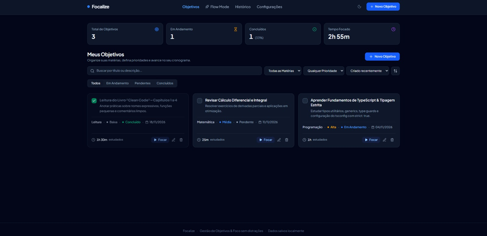

# Focalize 📚

Aplicação web para organizar seus objetivos de estudo e manter o foco.

🔗 https://focalize-imers-o-src.vercel.app/

## Sobre 💬
- Gerenciador de objetivos de estudo, simples e rápido
- Dados salvos no navegador (localStorage), sem cadastro e sem backend
- Projeto criado na imersão **Da ideia ao código: desenvolva com agentes de IA** (Alura)
- Desenvolvido com o Google AI Studio, a partir de prompts estruturados em etapas

## Funcionalidades
- **CRUD completo**: criar, listar, editar e excluir objetivos
- **Flow Mode**: modo foco com timer, um objetivo por vez
- Registro das sessões de estudo
- Dados persistentes ao recarregar a página
- Interface responsiva

## Tecnologias ⚙️
- React
- TypeScript
- Vite
- Tailwind CSS
- localStorage
- Deploy na Vercel

## Aprendizados 🧠
- Escrever bons prompts: primeiro estruturar a ideia, depois pedir o código
- Componentização com React + TypeScript
- Persistência de dados no navegador
- Publicação e resolução de erros de deploy na Vercel

## Autor
**Miguel Miada**
- GitHub: [@miguelmiada](https://github.com/miguelmiada)
- LinkedIn: https://www.linkedin.com/in/miguel-miada/
